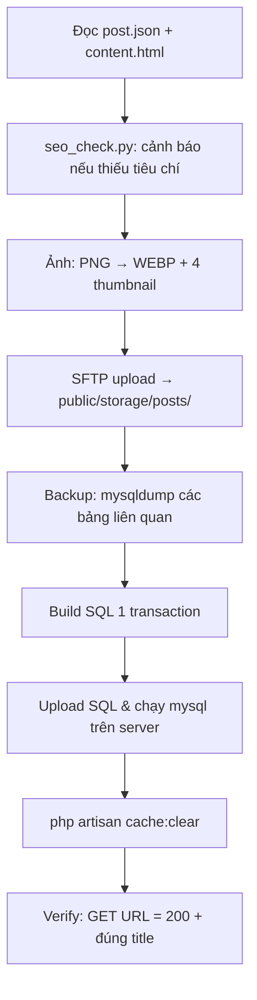

# Kế hoạch: Tự động đăng bài Blog (SEO) lên teamdevdesign.net qua SSH + Python

> Thư mục `plan/` đã nằm trong `ignore` của [sftp.json](../.vscode/sftp.json) → **không bị upload lên server**, nên an toàn để chứa script và nháp bài.

---

## 1. Kết quả khảo sát (đã kiểm tra thực tế trên server, chỉ đọc)

### 1.1 Server
| Mục | Giá trị |
|---|---|
| SSH | Lấy từ `.vscode/sftp.json` (host, port 65002, user) — **không hardcode trong script** |
| Thư mục web | `/home/u850692085/domains/teamdevdesign.net/public_html/` |
| DB | Đọc từ `.env` **trên server** (khác với `.env` local!) |
| APP_URL | `https://teamdevdesign.net` |
| Công cụ | Có sẵn `mysql`, `php` trên server; local có Python 3.10 + `paramiko 5` + `Pillow 12` |

### 1.2 Cấu trúc DB của plugin Blog (Botble CMS)
| Bảng | Dùng để | Ghi chú quan trọng |
|---|---|---|
| `posts` | Bài viết (bản **Tiếng Việt** – ngôn ngữ mặc định) | `author_id=1`, `author_type='Botble\ACL\Models\User'`, `status='published'`, `image='posts/<file>.webp'` |
| `posts_translations` | Bản dịch | Bài hiện có đều có 1 dòng `lang_code='en_US'` (copy) |
| `slugs` | URL tĩnh | Post: `prefix=''` → URL `https://teamdevdesign.net/<slug>`; Category: `prefix=''`; Tag: `prefix='tag'` |
| `meta_boxes` | SEO | `meta_key='seo_meta'`, `meta_value='[{"seo_title":"…","seo_description":"…","index":"index","seo_image":"posts\/x.webp"}]'` (JSON kiểu PHP: unicode `\uXXXX`, `/` → `\/`) |
| `post_categories` | Gắn danh mục | `(category_id, post_id)` |
| `tags`, `post_tags` | Thẻ | Tag mới cần thêm `slugs` prefix `tag` |
| `media_files` | Thư viện ảnh | `folder_id=6` (folder `posts`), `user_id=1`, `options='[]'`, `visibility='public'` |
| `language_meta` | — | Post **không dùng** bảng này (không có dòng nào) → bỏ qua |

### 1.3 Ảnh
- File lưu tại `public/storage/posts/`.
- Botble sinh sẵn thumbnail: `-150x150`, `-400x500`, `-600x400`, `-1280x400` → script phải tự sinh đủ 4 size (Pillow, crop center) để giao diện không vỡ.
- Định dạng: **webp** (nhẹ, chuẩn Core Web Vitals).

### 1.4 Danh mục hiện có
`10 Laravel` · `11 TK Website TMĐT` · `12 TK Website BĐS` · `15 Zalo mini app` · `16 Kiến thức về AI` · `17 TK Website Doanh nghiệp`
→ **Chưa có danh mục về Hosting/VPS/aaPanel** → đề xuất tạo mới: **"Hosting & VPS"** (slug `hosting-vps`).

---

## 2. Cấu trúc thư mục đề xuất (tái sử dụng cho mọi bài sau)

```
plan/
├── blog-automation-plan.md        ← file này
├── PROMPT_TEMPLATE.md             ← mẫu prompt để sau này chỉ cần điền & gửi
└── blog/
    ├── tools/
    │   ├── config.py              ← đọc sftp.json + .env server (không hardcode mật khẩu)
    │   ├── ssh_client.py          ← kết nối SSH/SFTP (paramiko)
    │   ├── image_tool.py          ← convert webp + sinh 4 thumbnail
    │   ├── sql_builder.py         ← build SQL an toàn (escape chuẩn MySQL, transaction)
    │   ├── publish_post.py        ← CLI chính: validate → ảnh → upload → DB → clear cache → verify
    │   └── seo_check.py           ← chấm điểm SEO trước khi đăng
    └── posts/
        └── <slug>/                ← MỖI BÀI 1 THƯ MỤC
            ├── post.json          ← metadata (title, slug, SEO, category, tags…)
            ├── content.html       ← nội dung HTML (đúng style bài cũ: h2/h3 + span font-size)
            └── images/            ← featured.png + ảnh minh hoạ trong bài
```

### 2.1 Mẫu `post.json`
```json
{
  "name": "Hướng Dẫn Cài Đặt Mail Server Trên aaPanel Từ A–Z (2026)",
  "slug": "huong-dan-cai-dat-mail-server-tren-aapanel",
  "description": "Mô tả ngắn ≤ 400 ký tự (hiển thị ở list bài).",
  "seo_title": "≤ 60 ký tự, chứa từ khoá chính",
  "seo_description": "120–160 ký tự, chứa từ khoá chính + CTA",
  "focus_keyword": "cài đặt mail server trên aapanel",
  "category": { "name": "Hosting & VPS", "slug": "hosting-vps" },
  "tags": ["aaPanel", "Mail Server", "RoundCube", "VPS"],
  "featured_image": "images/featured.png",
  "inline_images": ["images/dns-records.png", "images/mail-flow.png"],
  "is_featured": 0,
  "status": "published",
  "translation_en": "copy",
  "schema_type": "BlogPosting",
  "author_bio": "Chuyên gia Server & Web Development",
  "date_published": "YYYY-MM-DD"
}
```

---

## 3. Bài đầu tiên: "Cài đặt & sử dụng Mail Server trên aaPanel"

### 3.1 Phân tích bài nguồn (dotrungquan.info – 2021)
- 5 bước: cài PHP ≤ 7.3 → cài RoundCube qua One-Click → cài Mail Server → cấu hình MX/TXT → tạo user & test gửi Gmail.
- **Điểm yếu (cơ hội SEO cho mình):** nội dung cũ (2021, PHP 7.3), ~3 phút đọc, thiếu SPF/DKIM/DMARC, PTR (rDNS), mở port firewall, SSL cho mail, kiểm tra spam score, FAQ, troubleshooting.

### 3.2 Dàn ý bài mới (Chuẩn SEO Top 1, E-E-A-T & GEO) – mục tiêu ~2.000–2.500 từ
- **Intro**: Nêu rõ kinh nghiệm thực tế (Ví dụ: "Đã test trên aaPanel phiên bản mới nhất, Ubuntu 22.04"), vì sao nên tự host email (chi phí, chuyên nghiệp) + nêu nhanh kết quả cuối (Score mail-tester 10/10).
- **Mục lục (Table of Contents)**: Để SXO (Search Experience Optimization) và AI dễ đọc.
- **H2 1. Mail Server trên aaPanel là gì?** (Postfix + Dovecot + RoundCube).
- **H2 2. Chuẩn bị trước khi cài (Checklist cực kỳ quan trọng)**: VPS ≥ 2GB RAM, **kiểm tra nhà cung cấp chặn port 25 không**, domain, quyền sửa DNS, hostname, Redis. (Tạo bảng để AI Overview dễ trích xuất).
- **H2 3. Bước 1 – Đặt hostname & cài Redis** (lệnh `hostnamectl`, bảo mật).
- **H2 4. Bước 2 – Cài Mail Server từ App Store**.
- **H2 5. Bước 3 – Thêm domain & cấu hình DNS** (Infographic bản ghi A, MX, SPF, DKIM, DMARC, PTR. Nhắc **tắt proxy mây cam**). *Format rõ ràng từng bước để dễ vào Featured Snippet*.
- **H2 6. Bước 4 – Cài RoundCube (Webmail) qua One-Click Deployment**.
- **H2 7. Bước 5 – Bật SSL & cấu hình Firewall** (Các port cần thiết).
- **H2 8. Bước 6 – Tạo tài khoản email & test spam score** (Mục tiêu 10/10 trên mail-tester).
- **H2 9. Lỗi thường gặp & cách khắc phục (Troubleshooting)** (DKIM fail, port 25 bị chặn).
- **H2 10. So sánh tự host vs Google Workspace/Zoho** (Internal link về dịch vụ TeamDevDesign).
- **H2 Câu hỏi thường gặp (FAQ)**: Trả lời trực diện, answer-first (câu ngắn) để AI có thể trích xuất (GEO). (Cài đặt QAPage Schema nếu là comment thật, nếu không chỉ dùng HTML format rõ ràng).
- **Kết luận + Thông tin Tác giả (E-E-A-T)**: Củng cố Trust và Expertise. CTA liên hệ TeamDevDesign.

### 3.3 Checklist Chuẩn SEO Nâng Cao (E-E-A-T, Schema & AI GEO) (`seo_check.py` sẽ tự kiểm)
**SEO Cơ Bản (On-page):**
- [ ] Từ khoá chính xuất hiện ở: title, slug, seo_title, seo_description, 100 từ đầu, ≥ 1 H2, alt ảnh đại diện.
- [ ] seo_title ≤ 60 ký tự, seo_description 120–160 ký tự (chứa CTA).
- [ ] Chỉ **1 H1**, các heading tuân thủ hệ thống phân cấp (H1 -> H2 -> H3) rõ ràng, không nhảy bậc.
- [ ] Ảnh có `alt` mô tả + `loading="lazy"` + kích thước `width/height` (tối ưu LCP, CLS trong Core Web Vitals). Đuôi ảnh `.webp`.
- [ ] Mật độ từ khoá ~1–2%, bổ sung từ khoá phụ LSI/Semantic: *tạo email domain, roundcube aapanel, dkim spf dmarc*.
- [ ] ≥ 3-5 internal link (bài/dịch vụ liên quan) mỗi 1000 từ. 1–2 external link tới nguồn cực kỳ uy tín (Microsoft, Google, aaPanel docs).

**Tối ưu E-E-A-T (Google Helpful Content):**
- [ ] **Experience (Kinh nghiệm):** Thể hiện trải nghiệm thực tế (ảnh chụp màn hình thực tế, kết quả thực tế, cấu hình test thành công).
- [ ] **Expertise (Chuyên môn) & Trust (Độ tin cậy):** Có tác giả rõ ràng, có thông tin liên hệ. Bài viết tập trung giải quyết vấn đề của người dùng, không viết dông dài câu chữ.

**Tối ưu AI Search & GEO (Generative Engine Optimization):**
- [ ] Cấu trúc bài viết có **Table of Contents (Mục lục)**.
- [ ] Sử dụng định dạng **Answer-first** (Trả lời trực diện) cho các câu hỏi quan trọng, cấu trúc dưới dạng Q&A, danh sách hoặc bảng biểu để AI dễ trích xuất (AI Overviews, ChatGPT).
- [ ] Đoạn văn ngắn (2-4 câu), ngôn từ mạch lạc, không dùng văn mẫu AI chung chung, cung cấp "Original insight" (Góc nhìn độc đáo).

**Schema Markup (JSON-LD):**
- [ ] Cần tạo và nhúng JSON-LD Schema `BlogPosting` hoặc `Article` vào file HTML cuối cùng.
- [ ] Nếu có FAQ thì thiết kế rõ ràng bằng HTML. (Lưu ý: Google đã bỏ rich result cho FAQPage Schema, nên chỉ cần trình bày semantic HTML tốt là đủ, không bắt buộc chèn FAQPage schema).

### 3.4 Ảnh cần tạo (bằng AI image generation)
| File | Nội dung | Dùng |
|---|---|---|
| `featured.png` (16:9) | Banner "Mail Server trên aaPanel" phong cách tech, tông màu thương hiệu | Ảnh đại diện + `seo_image` |
| `mail-flow.png` | Sơ đồ luồng gửi/nhận mail: Client → Postfix → Dovecot → RoundCube | Trong H2 1 |
| `dns-records.png` | Infographic các bản ghi A/MX/SPF/DKIM/DMARC | Trong H2 5 |

> ⚠️ Không thể chụp screenshot thật của aaPanel → dùng infographic minh hoạ. Nếu bạn có screenshot thật thì bỏ vào `images/` để thay.

---

## 4. Quy trình `publish_post.py` (an toàn, chạy lại được)



**Thứ tự insert trong 1 transaction (`START TRANSACTION … COMMIT`):**
1. `media_files` (ảnh đại diện + ảnh inline) – bỏ qua nếu `url` đã tồn tại.
2. `categories` + `slugs` (nếu danh mục chưa có).
3. `tags` + `slugs (prefix='tag')` (tag chưa có), lấy lại id nếu đã có.
4. `posts` → lấy `@post_id := LAST_INSERT_ID()`.
5. `posts_translations` (`en_US`, copy theo pattern hiện tại).
6. `slugs` (`reference_type='Botble\Blog\Models\Post'`, `prefix=''`).
7. `meta_boxes` (`seo_meta`).
8. `post_categories`, `post_tags`.

**Cơ chế an toàn:**
- `--dry-run`: chỉ in SQL, không ghi DB.
- Slug đã tồn tại → dừng (hoặc `--update` để cập nhật bài cũ thay vì tạo trùng).
- Mật khẩu chỉ đọc từ `sftp.json` + `.env` server lúc chạy; dùng `MYSQL_PWD` env, không in ra log.
- Backup SQL lưu ở `plan/backups/<timestamp>.sql` trước mỗi lần ghi.
- Lỗi giữa chừng → `ROLLBACK`, xoá file SQL tạm trên server.

---

## 5. Mẫu prompt cho các bài sau (`PROMPT_TEMPLATE.md`)

```
Viết bài blog mới theo plan/docs/blog-automation-plan.md
- Chủ đề / URL tham khảo: <url hoặc chủ đề>
- Từ khoá chính: <keyword>
- Danh mục: <tên danh mục có sẵn hoặc mới>
- Tags: <tag1, tag2>
- Số ảnh: <1 đại diện + N minh hoạ>
- Đăng luôn hay chỉ dry-run: <publish | dry-run>
```
→ Agent sẽ: tạo `plan/posts/<slug>/` → viết `content.html` + `post.json` → tạo ảnh → chạy `seo_check.py` → `publish_post.py`.

---

## 6. Các bước thực hiện — ✅ HOÀN THÀNH 05/10/2026

| # | Việc | Output | Trạng thái |
|---|---|---|---|
| 1 | Viết bộ tools Python (mục 2) | `plan/tools/*.py` | ✅ |
| 2 | Viết bài aaPanel Mail Server (~2.160 từ, 12 H2) | `plan/posts/huong-dan-cai-dat-mail-server-tren-aapanel/` | ✅ |
| 3 | Tạo 3 ảnh AI | `images/*.jpg` → webp | ✅ |
| 4 | Chạy `--dry-run` | `build/publish.sql` | ✅ |
| 5 | Publish thật + clear cache | Post #64, Category #18, 5 tags mới | ✅ |
| 6 | Verify bằng trình duyệt | HTTP 200, ảnh/bảng/tags/danh mục hiển thị đúng | ✅ |
| 7 | Viết `PROMPT_TEMPLATE.md` + `blog/README.md` | Dùng cho bài sau | ✅ |

---

## 7. Quyết định đã chốt (05/10/2026)
1. **Danh mục**: các danh mục hiện có không phù hợp → **tạo mới "Hosting & VPS"** (slug `hosting-vps`). Với bài sau: ưu tiên danh mục có sẵn, chỉ tạo mới khi không phù hợp.
2. **Slug**: `huong-dan-cai-dat-mail-server-tren-aapanel`.
3. **Bản dịch en_US**: copy nội dung tiếng Việt (giống pattern các bài hiện có).
4. **Trạng thái**: đăng luôn (`published`).
