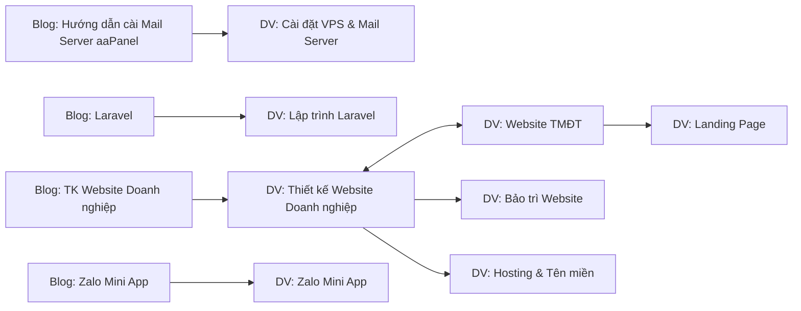

# Kế hoạch SEO Top 1 cho trang Dịch vụ (Services) – teamdevdesign.net

> Cập nhật: 07/10/2026 · Áp dụng cho plugin `portfolio` (bảng `pf_services`, URL `https://teamdevdesign.net/services/<slug>`).
> Đi kèm [blog-automation-plan.md](blog-automation-plan.md): blog = kéo traffic thông tin, **dịch vụ = trang chốt đơn (money page)**.

---

## 1. Kết quả audit thực tế (đã kiểm tra trên server + trang live, chỉ đọc)

### 1.1 Dữ liệu hiện có
| ID | Dịch vụ | Slug | Danh mục | Độ dài content | SEO meta |
|---|---|---|---|---|---|
| 1 | Thiết kế Website Doanh nghiệp | `thiet-ke-website-doanh-nghiep` | Website Doanh Nghiệp | ~3.5k ký tự (~550 từ) | Có, nhưng title = tên, desc 105 ký tự, ảnh = logo |
| 2 | Website Thương mại điện tử | `thiet-ke-website-thuong-mai-dien-tu` | E-commerce | ~4.4k (~700 từ) | ❌ Trống |
| 3 | Landing Page & Website Marketing | `landing-page-website-marketing` | Tin tức/Blog (**sai danh mục**) | ~2.5k (~400 từ) | ❌ Trống |
| 4 | Bảo trì & Quản trị Website | `bao-tri-quan-tri-website` | Bảo trì & Nâng cấp | ~2.7k (~420 từ) | ❌ Trống |
| 5 | Nâng cấp & Tối ưu Website | `nang-cap-toi-uu-website` | Bảo trì & Nâng cấp | ~2.7k (~420 từ) | ❌ Trống |
| 6 | Dịch vụ Hosting & Tên miền | `dich-vu-hosting-ten-mien` | Bảo trì & Nâng cấp | ~2.7k (~420 từ) | ❌ Trống |

Danh mục: `1 Website Doanh Nghiệp` · `2 Website TMĐT (E-commerce)` · `3 Website Tin tức / Blog / Cổng thông tin` · `4 Dịch vụ Bảo trì & Nâng cấp Website`.

### 1.2 Lỗi SEO kỹ thuật phát hiện trên trang live
| # | Vấn đề | Mức độ | Trạng thái |
|---|---|---|---|
| 1 | **Trang không có thẻ H1** (tiêu đề trang là `<h3>`) | 🔴 Nghiêm trọng | ✅ Đã sửa code |
| 2 | **Không có thẻ `<link rel="canonical">`** (blog có, dịch vụ không) | 🔴 Nghiêm trọng | ✅ Đã sửa code |
| 3 | Không có Schema `Service` (chỉ có `BreadcrumbList`) | 🟠 Cao | ✅ Đã sửa code |
| 4 | Breadcrumb thiếu cấp danh mục (Trang chủ › Dịch vụ) | 🟡 TB | ✅ Đã sửa code |
| 5 | `og:type=article` (sai cho trang dịch vụ), OG image luôn là logo | 🟡 TB | ✅ Đã sửa code (`website` + ảnh dịch vụ) |
| 6 | Heading trong nội dung dùng **H4/H5**, không có H2/H3 | 🔴 Nghiêm trọng | ⏳ Sửa nội dung (mục 4) |
| 7 | 5/6 dịch vụ **không có seo_title / seo_description** | 🔴 Nghiêm trọng | ⏳ Mục 3 |
| 8 | Nội dung mỏng (400–700 từ) – đối thủ top 1 thường 1.500–2.500 từ | 🟠 Cao | ⏳ Mục 4 |
| 9 | FAQ dùng chung `[faqs category_ids="1,2"]` cho mọi dịch vụ → **trùng lặp nội dung** | 🟠 Cao | ⏳ Mục 4.3 |
| 10 | Quy trình 5 bước viết bằng `<p>` thay vì `<ol>` (khó vào Featured Snippet) | 🟡 TB | ⏳ Mục 4 |
| 11 | Không có bảng giá/khoảng giá trên trang (người dùng & AI hay tìm "giá") | 🟠 Cao | ⏳ Mục 4 |
| 12 | Không có internal link từ blog → dịch vụ và giữa các dịch vụ trong nội dung | 🟠 Cao | ⏳ Mục 6 |
| 13 | Landing Page nằm sai danh mục "Tin tức/Blog" | 🟡 TB | ⏳ Đổi sang danh mục 1 hoặc tạo danh mục "Marketing" |

**Đã đạt:** `robots=index,follow` ✅ · services có trong sitemap ✅ · 0 ảnh thiếu `alt` ✅ · URL ngắn, không dấu ✅ · HTTPS ✅.

---

## 2. Code đã sửa (cần upload lên server)

| File | Thay đổi |
|---|---|
| [PublicController.php](../platform/plugins/portfolio/src/Http/Controllers/PublicController.php) | Thêm canonical `SeoHelper::meta()->setUrl()`, OG image từ ảnh dịch vụ, `og:type=website`, breadcrumb thêm cấp danh mục, eager-load `category` |
| [breadcrumb.blade.php](../platform/themes/infinia/partials/breadcrumb.blade.php) | Tiêu đề trang có thể đổi thẻ qua `Theme::set('pageHeadingTag','h1')` (mặc định vẫn H3 → các trang khác không bị 2 H1). H1 giữ nguyên cỡ chữ 38px |
| [service.blade.php](../platform/themes/infinia/views/portfolio/service.blade.php) | H1 = tên dịch vụ; JSON-LD `Service` + `provider: Organization` (name, url, logo, telephone, areaServed) |

> Sau khi upload: `php artisan cache:clear` → kiểm tra bằng [Rich Results Test](https://search.google.com/test/rich-results) và xem nguồn trang có `<h1>`, `rel="canonical"`, `"@type":"Service"`.

---

## 3. Bản đồ từ khoá & SEO meta cho 6 dịch vụ hiện có

> Nguyên tắc: **1 trang = 1 từ khoá chính (search intent thương mại)**. Không đổi slug (đã index, đổi sẽ mất thứ hạng). Blog chỉ nhắm từ khoá thông tin ("là gì", "hướng dẫn") rồi link về dịch vụ → tránh ăn thịt từ khoá (cannibalization).

| ID | Từ khoá chính | Từ khoá phụ (LSI) | seo_title (≤ 60) | seo_description (120–160, có CTA) |
|---|---|---|---|---|
| 1 | thiết kế website doanh nghiệp | thiết kế web công ty, website giới thiệu doanh nghiệp, giá thiết kế website doanh nghiệp | Thiết Kế Website Doanh Nghiệp Chuẩn SEO \| TeamDevDesign | Thiết kế website doanh nghiệp độc quyền trên Laravel, chuẩn SEO, tải dưới 2s, bàn giao CMS dễ dùng. Bảo hành trọn đời – nhận báo giá miễn phí hôm nay! |
| 2 | thiết kế website thương mại điện tử | thiết kế website bán hàng, web bán hàng online, tích hợp VNPay/MoMo | Thiết Kế Website Thương Mại Điện Tử, Bán Hàng Online | Thiết kế website thương mại điện tử tối ưu chuyển đổi: giỏ hàng, thanh toán VNPay/MoMo, kết nối GHN/GHTK, quản lý kho. Tư vấn & báo giá miễn phí! |
| 3 | thiết kế landing page | landing page bán hàng, landing page chạy quảng cáo, tối ưu chuyển đổi | Thiết Kế Landing Page Chuyển Đổi Cao, Tải Dưới 2 Giây | Thiết kế landing page bán hàng chuyên nghiệp, tối ưu CRO, tích hợp GA4, Pixel, form thu lead. Bàn giao nhanh 3–5 ngày – nhận demo miễn phí ngay! |
| 4 | dịch vụ bảo trì website | quản trị website, chăm sóc website, backup website | Dịch Vụ Bảo Trì Website Trọn Gói, Hỗ Trợ Nhanh 24/7 | Dịch vụ bảo trì & quản trị website: backup hằng ngày, vá bảo mật, cập nhật, tối ưu tốc độ, xử lý sự cố nhanh. Yên tâm kinh doanh – liên hệ tư vấn ngay! |
| 5 | tối ưu tốc độ website | nâng cấp website, core web vitals, pagespeed 90+ | Tối Ưu Tốc Độ & Nâng Cấp Website – PageSpeed 90+ | Nâng cấp & tối ưu tốc độ website đạt PageSpeed 90+, chuẩn Core Web Vitals, nâng cấp Laravel/PHP mới, giữ nguyên dữ liệu. Kiểm tra website miễn phí! |
| 6 | dịch vụ hosting và tên miền | đăng ký tên miền, hosting tốc độ cao, VPS aaPanel | Dịch Vụ Hosting & Tên Miền Tốc Độ Cao, Giá Tốt | Đăng ký tên miền & hosting/VPS tốc độ cao, SSL miễn phí, cài đặt aaPanel, email theo tên miền, hỗ trợ kỹ thuật tận tình. Nhận tư vấn gói phù hợp ngay! |

**Mỗi dịch vụ cũng cần:**
- `description` (mô tả ngắn hiển thị list) chứa từ khoá chính, ≤ 160 ký tự.
- `seo_image`: ảnh riêng **1200×630 .webp** (không dùng logo chung) → hiển thị đẹp khi share Facebook/Zalo.
- Ảnh đại diện có `alt` = tên dịch vụ (code đã tự lấy `$service->name`).

---

## 4. Khung nội dung chuẩn cho 1 trang dịch vụ (1.500–2.000 từ)

> Trong trình soạn thảo admin: đổi **"Tiêu đề 4" → "Tiêu đề 2"**, **"Tiêu đề 5" → "Tiêu đề 3"**. Không dùng H1 trong nội dung (H1 đã là tên dịch vụ ở đầu trang).

```
H1 (tự động) Thiết kế Website Doanh nghiệp
├─ Đoạn mở đầu (answer-first, 2–3 câu, có từ khoá trong 100 từ đầu + 1 con số cụ thể)
├─ [content-checklist]  ← 6 lợi ích chính
├─ H2 Dịch vụ thiết kế website doanh nghiệp bao gồm những gì?
│   └─ [content-features] (3 khối) + H3 cho từng hạng mục nếu viết dài
├─ H2 Bảng giá thiết kế website doanh nghiệp (2026)
│   └─ <table> 3 gói: Cơ bản / Chuyên nghiệp / Cao cấp (khoảng giá, thời gian, tính năng) + link [packages]
├─ H2 Quy trình 5 bước triển khai
│   └─ <ol> 1. Tư vấn … 5. Bàn giao & đào tạo  (mỗi bước 1–2 câu, có thời gian)
├─ H2 Dự án tiêu biểu  ← 3 link tới /projects/... (E-E-A-T: Experience)
├─ H2 Vì sao chọn TeamDevDesign?
│   └─ Số liệu thật: số dự án, năm kinh nghiệm, PageSpeed thực tế, bảo hành
├─ H2 So sánh: Website thiết kế riêng vs dùng template/WordPress (bảng)
├─ H2 Câu hỏi thường gặp về thiết kế website doanh nghiệp
│   └─ 5–7 câu hỏi RIÊNG cho dịch vụ này (answer-first, 40–60 từ/câu)
└─ CTA cuối: Hotline + form báo giá (sidebar đã có)
```

### 4.1 Checklist On-page cho mỗi trang dịch vụ
- [ ] Từ khoá chính có ở: seo_title, H1, slug, seo_description, 100 từ đầu, ≥ 1 H2, alt ảnh đại diện.
- [ ] 1 H1 duy nhất, H2 → H3 không nhảy bậc, **không còn H4/H5 làm tiêu đề mục**.
- [ ] ≥ 1.500 từ, đoạn văn 2–4 câu, có ≥ 1 bảng + ≥ 1 danh sách `<ol>/<ul>`.
- [ ] Có **giá hoặc khoảng giá** + thời gian triển khai.
- [ ] ≥ 3 internal link (dự án, dịch vụ liên quan, bài blog hướng dẫn) + 1 external link uy tín (Google Search Central, Laravel docs…).
- [ ] FAQ riêng (không trùng trang khác).
- [ ] Ảnh `.webp`, ≤ 150KB, có alt mô tả.
- [ ] seo_image 1200×630 riêng.

### 4.2 E-E-A-T (quyết định Top 1 cho từ khoá thương mại)
- **Experience:** ảnh/screenshot dự án thật, kết quả PageSpeed thật, case study ngắn ("Website X tăng 40% lead sau 3 tháng").
- **Expertise:** nêu công nghệ cụ thể (Laravel 11, Botble CMS, Redis, CDN), tên người phụ trách.
- **Trust:** địa chỉ, hotline, MST (nếu có), chính sách bảo hành, đánh giá khách hàng (testimonials shortcode).

### 4.3 FAQ riêng cho từng dịch vụ
Tạo trong admin **Câu hỏi thường gặp → Danh mục**: mỗi dịch vụ 1 danh mục FAQ, rồi đổi shortcode `[faqs category_ids="<id riêng>"]`. Ví dụ dịch vụ 1:
1. Thiết kế website doanh nghiệp mất bao lâu? → 2–4 tuần tuỳ quy mô…
2. Chi phí thiết kế website doanh nghiệp bao nhiêu?
3. Website có chuẩn SEO và chạy tốt trên điện thoại không?
4. Sau khi bàn giao tôi có tự sửa nội dung được không?
5. Có hỗ trợ hosting, tên miền và bảo hành không?

---

## 5. Dịch vụ MỚI đề xuất thêm (cơ hội từ khoá ít cạnh tranh, khớp blog sẵn có)

| Ưu tiên | Dịch vụ | Slug | Từ khoá chính | Danh mục | Lý do |
|---|---|---|---|---|---|
| ⭐ 1 | Lập trình Zalo Mini App | `lap-trinh-zalo-mini-app` | lập trình zalo mini app | Mới: "Ứng dụng & Zalo Mini App" | Xu hướng 2025–2026, ít đối thủ, đã có blog danh mục Zalo mini app để link về |
| ⭐ 2 | Thiết kế Website Bất động sản | `thiet-ke-website-bat-dong-san` | thiết kế website bất động sản | Website Doanh Nghiệp | Có danh mục blog "TK Website BĐS", intent mua cao |
| ⭐ 3 | Lập trình Web Laravel theo yêu cầu | `lap-trinh-web-laravel-theo-yeu-cau` | lập trình web laravel | Mới: "Phát triển phần mềm" | Thế mạnh cốt lõi, có danh mục blog Laravel |
| 4 | Thiết kế Website Tin tức / Blog | `thiet-ke-website-tin-tuc` | thiết kế website tin tức | Tin tức/Blog (danh mục 3 hiện **chưa có dịch vụ nào đúng**) | Lấp danh mục trống |
| 5 | Cài đặt VPS, aaPanel & Mail Server | `cai-dat-vps-aapanel-mail-server` | dịch vụ cài đặt vps | Bảo trì & Nâng cấp | Bài blog aaPanel Mail Server đang có traffic → link CTA về đây |
| 6 | Tích hợp Chatbot AI cho Website | `tich-hop-chatbot-ai-website` | chatbot ai cho website | Mới: "Giải pháp AI" | Có danh mục blog "Kiến thức về AI", từ khoá đang tăng |

> Mỗi dịch vụ mới làm đúng khung mục 4 + checklist 4.1 trước khi xuất bản.

---

## 6. Liên kết nội bộ (Topic Cluster)



- Mỗi bài blog: ≥ 1 link về dịch vụ liên quan với anchor = từ khoá chính của dịch vụ (vd: "dịch vụ thiết kế website doanh nghiệp").
- Menu "Dịch vụ" và footer "Dịch vụ chính" cập nhật thêm dịch vụ mới.
- Trang chủ: khối dịch vụ link tới đủ các trang dịch vụ.

---

## 7. Off-page & theo dõi
- [ ] Google Search Console: gửi lại sitemap, **Request indexing** từng URL dịch vụ sau khi sửa.
- [ ] Google Business Profile: thêm danh sách dịch vụ, link về đúng URL dịch vụ (rất mạnh cho tìm kiếm "… tại TP.HCM").
- [ ] Thêm "TP.HCM" / "Hồ Chí Minh" tự nhiên vào nội dung 1–2 lần (local SEO).
- [ ] Theo dõi thứ hạng 6 từ khoá chính mỗi tuần (GSC → Hiệu suất → lọc theo trang).

---

## 8. Các bước thực hiện

| # | Việc | Trạng thái |
|---|---|---|
| 1 | Audit DB + trang live | ✅ 07/10/2026 |
| 2 | Sửa code: H1, canonical, Service schema, breadcrumb, OG | ✅ Local – **chờ upload** |
| 3 | Cập nhật seo_title / seo_description / description 6 dịch vụ (mục 3) | ⏳ Chờ duyệt |
| 4 | Viết lại nội dung 6 dịch vụ theo khung mục 4 (H2/H3, bảng giá, FAQ riêng) | ⏳ Chờ duyệt |
| 5 | Tạo 6 dịch vụ mới (mục 5) – ưu tiên ⭐ trước | ⏳ Chờ duyệt |
| 6 | Internal link từ blog + menu/footer | ⏳ |
| 7 | GSC request indexing + GBP | ⏳ (người dùng làm) |
